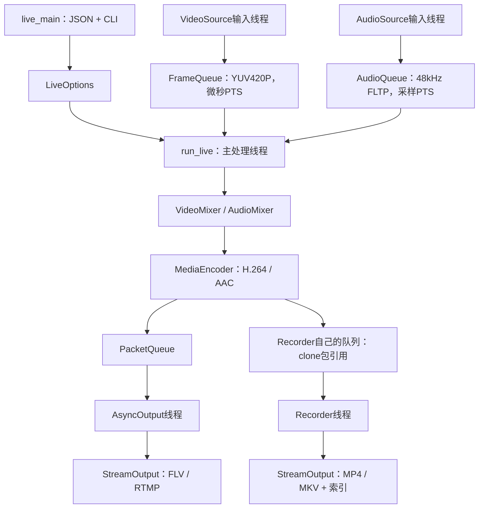
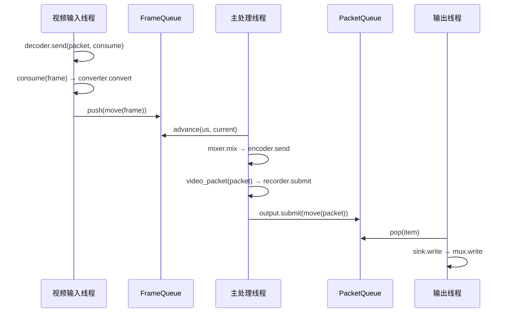

# 完整代码阅读指南

对应版本：2026-11-09收敛后的代码。本文逐个解释仓库中的全部自有`.h`、`.cpp`，并说明第三方PicoJSON头文件。
阅读目标是能回答：这个文件谁调用、处理什么数据、在哪个线程执行、把结果交给谁、资源由谁释放。
这是当前实现说明；真实网络与长期运行的验收状态仍以开发计划和测试报告为准。

源码现在配有两层说明：文件顶部的“初学者导读”交代模块位置、数据格式和注意事项；函数、成员及复杂分支旁的注释解释调用条件、所有权、时间单位和失败处理。
本指南用于跨文件追踪，源码注释用于理解眼前的实现。第三方PicoJSON不改动，项目的严格解析规则集中在`src/config/live_config.cpp`。

如果还不知道从哪个cpp开始，请先读[第一次读代码：一步步路线](first-code-walkthrough.md)。本文作为查阅手册，主线阅读不必一次覆盖全部文件。

## 目录

1. [先建立整体结构](#overview)
2. [三个程序怎样构建和启动](#build)
3. [逐文件阅读手册](#files)
4. [跟踪一帧视频和一块音频](#trace)
5. [主循环中的变量与调度](#scheduler)
6. [所有权与线程交接](#ownership)
7. [时间戳换算实例](#timestamps)
8. [背压、恢复和退出](#recovery)
9. [回放链路与测试对应关系](#tests)
10. [建议阅读顺序和GDB观察点](#debug)

<a id="overview"></a>
## 1. 先建立整体结构

项目只有两个业务入口：完整直播`esports_live`和独立录像工具`esports_replay`；`ffmpeg_env_check`辅助诊断。
完整直播的组装中心是`run_live`，位于`src/manager/live_pipeline.cpp`。
它没有一个隐藏的StreamManager类，也没有另一个独立的AVSynchronizer调度线程：
输入线程归各Source管理，节目调度和生命周期协调集中在run_live，同步工具在sync目录。



从目录上理解：common负责共同基础，config负责启动参数，input负责源线程，codec负责编解码与视频转换，
queue负责跨线程传递，sync负责输入时钟与重采样，mixer负责原始媒体合成，output负责发包，
recording负责独立存档，monitor负责指标，manager负责把它们组装成节目。

不要把include关系等同于运行时调用关系：头文件让编译器认识类型，真正的调用发生在函数体；
`FrameConsumer`和`PacketConsumer`回调本身不创建线程。后面逐文件说明分别指出这两层关系。

<a id="build"></a>
## 2. 三个程序怎样构建和启动

[CMakeLists.txt](../CMakeLists.txt)强制C++11，pkg-config导入六个FFmpeg库，Threads提供线程链接参数。

| 构建目标 | 包含/依赖 | 用途 |
|---|---|---|
| project_options | 警告编译选项 | INTERFACE目标，不生成业务代码 |
| esports_common | logger.cpp + Threads | 公共日志 |
| esports_media | 输入、编解码、混合、同步、输出、录制、指标、live_pipeline | 共用媒体实现 |
| esports_config | live_config.cpp + esports_media | JSON适配；PicoJSON为私有头文件依赖 |
| esports_live | live_main.cpp + esports_config | 完整直播入口 |
| esports_replay | replay_main.cpp + esports_media | 独立录像工具 |
| ffmpeg_env_check | env_check_main.cpp + esports_common + FFmpeg | 环境诊断 |

`BUILD_TESTING=ON`时额外编译测试/夹具并注册CTest；安装规则只安装三个运行工具及JSON示例。
没有对应cpp的头文件不是缺失实现：队列、SourceClock、IoControl等在类内/inline函数里直接实现；
CodecMetrics::measure是模板，同样定义在头文件。

启动直播的实际调用链：

```text
main（live_main.cpp）
  ├─ 安装信号处理器，创建Logger
  ├─ 收集CLI和--config，识别CLI覆盖的字段/索引
  ├─ load_live_config → JSON转参数序列
  ├─ 合并 → 统一解析 → 默认值补全 → 范围/跨字段校验
  ├─ --check-config或--dump-config：在这里返回
  └─ run_live(options, stop_requested, log)
       ├─ 创建源线程和有界队列
       ├─ 创建编码器、滤镜和输出工作线程
       ├─ 调度循环
       └─ 排空、写尾、停止源、join、最终统计
```

JSON文件不会直接触发FFmpeg API。修改`output`最终影响run_live传给AsyncOutput::open的URL；
修改`video_queue_frames`最终影响VideoSource内FrameQueue容量；修改`audio_offsets_ms`最终参与AudioSource的采样PTS计算。
这种从字段追到实际消费者的方式，比只看配置解析器更能理解参数如何生效。

<a id="files"></a>
## 3. 逐文件阅读手册

下列目录可直接跳到对应文件说明。每项单独解释头文件与实现文件，链接打开的是仓库当前源码。

- [01. src/live_main.cpp](#file-01)
- [02. src/replay_main.cpp](#file-02)
- [03. src/env_check_main.cpp](#file-03)
- [04. include/common/ffmpeg.h](#file-04)
- [05. include/common/logger.h](#file-05)
- [06. src/common/logger.cpp](#file-06)
- [07. include/config/live_config.h](#file-07)
- [08. src/config/live_config.cpp](#file-08)
- [09. include/manager/live_pipeline.h](#file-09)
- [10. src/manager/live_pipeline.cpp](#file-10)
- [11. include/input/stream_input.h](#file-11)
- [12. src/input/stream_input.cpp](#file-12)
- [13. include/input/video_source.h](#file-13)
- [14. src/input/video_source.cpp](#file-14)
- [15. include/input/audio_source.h](#file-15)
- [16. src/input/audio_source.cpp](#file-16)
- [17. include/codec/media_codec.h](#file-17)
- [18. src/codec/media_codec.cpp](#file-18)
- [19. include/codec/video_converter.h](#file-19)
- [20. src/codec/video_converter.cpp](#file-20)
- [21. include/queue/frame_queue.h](#file-21)
- [22. include/queue/audio_queue.h](#file-22)
- [23. include/queue/packet_queue.h](#file-23)
- [24. include/sync/av_synchronizer.h](#file-24)
- [25. include/sync/audio_resampler.h](#file-25)
- [26. src/sync/audio_resampler.cpp](#file-26)
- [27. include/mixer/video_mixer.h](#file-27)
- [28. src/mixer/video_mixer.cpp](#file-28)
- [29. include/mixer/audio_mixer.h](#file-29)
- [30. src/mixer/audio_mixer.cpp](#file-30)
- [31. include/output/async_output.h](#file-31)
- [32. src/output/async_output.cpp](#file-32)
- [33. include/output/stream_output.h](#file-33)
- [34. src/output/stream_output.cpp](#file-34)
- [35. include/recording/recorder.h](#file-35)
- [36. src/recording/recorder.cpp](#file-36)
- [37. include/monitor/metrics.h](#file-37)
- [38. src/monitor/metrics.cpp](#file-38)
- [39. tests/logger_test.cpp](#file-39)
- [40. tests/video_reference_test.cpp](#file-40)
- [41. tests/frame_queue_test.cpp](#file-41)
- [42. tests/packet_queue_test.cpp](#file-42)
- [43. tests/audio_sync_test.cpp](#file-43)
- [44. tests/output_recovery_fixture.cpp](#file-44)
- [45. tests/recording_write_failure_fixture.cpp](#file-45)
- [46. third_party/picojson/picojson.h](#file-46)

<a id="file-01"></a>
### 3.1. [src/live_main.cpp](../src/live_main.cpp)

**职责：** 完整直播的进程入口，把配置转换成可执行的节目参数。

**主要接口与实现：** `main`、`integer`、`validate_layout`、`stop_handler`。先收集CLI及覆盖身份，再读取JSON，把合并结果交给统一解析和范围校验。

**怎样串起来：** 由操作系统启动；调用`load_live_config`/`serialize_live_config`，最后调用`run_live`。不是另一个媒体处理模块。

**阅读重点：** 信号处理器只设置sig_atomic_t；SIGPIPE/SIGXFSZ忽略后由I/O返回错误。check/dump分支在媒体资源创建前返回。CLI输入列表整体替换、增益和偏移按索引覆盖，不能把它理解为简单JSON对象合并。

<a id="file-02"></a>
### 3.2. [src/replay_main.cpp](../src/replay_main.cpp)

**职责：** 独立录像查询、关键帧片段提取和实时回放入口。

**主要接口与实现：** `main`先解析input/index、起点、时长和模式；索引定位后用`av_find_best_stream`选视频，用`av_seek_frame(..., AVSEEK_FLAG_BACKWARD)`定位；循环读取并转封装。

**怎样串起来：** 直接使用`StreamInput`和`StreamOutput`，不经过run_live、VideoMixer或MediaEncoder；extract快速写出，replay按DTS节奏发送。

**阅读重点：** 仅支持本项目无B帧H.264录像及兼容音轨；起点向前对齐关键帧，实际片段可能更长。索引请求不自动跨段；回放不插入正在进行的直播，也没有AsyncOutput重连。

<a id="file-03"></a>
### 3.3. [src/env_check_main.cpp](../src/env_check_main.cpp)

**职责：** 检查FFmpeg编译头文件和运行库是否匹配，并查询所需注册能力。

**主要接口与实现：** `version_string`展开版本号；`check_library`比较主版本；`has_rtmp_output`遍历输出协议；`main`检查六库及libx264/AAC/FLV/RTMP。

**怎样串起来：** 链接公共日志和FFmpeg，独立运行；不进入直播或回放流水线。

**阅读重点：** 主版本检查通过决定成功状态，编码器/协议缺失会打印警告；能力已注册不等于实际编码或网络连接已成功。

<a id="file-04"></a>
### 3.4. [include/common/ffmpeg.h](../include/common/ffmpeg.h)

**职责：** FFmpeg错误、Packet所有权、网络初始化和I/O中断的公共基础；全部内联，没有对应cpp。

**主要接口与实现：** `ff_check`、`PacketDeleter`/`Packet`、`make_packet`、`IoControl`、`NetworkRuntime`、`is_network_input`。

**怎样串起来：** 被输入、输出、队列、编解码等模块使用。IoControl借用主线程信号标志或线程atomic停止标志，其callback再被FFmpeg调用。

**阅读重点：** arm在每次阻塞I/O前刷新截止时间；finishing模式忽略停止标志但仍超时。IoControl必须活得比借用它的FFmpeg I/O对象久；Packet负责外壳及缓冲引用释放。

<a id="file-05"></a>
### 3.5. [include/common/logger.h](../include/common/logger.h)

**职责：** 声明统一日志等级和线程安全Logger接口。

**主要接口与实现：** `LogLevel`、`Logger(output, minimum)`、`log`；成员包括借用ostream、固定最低等级及mutex。

**怎样串起来：** 三个运行入口创建Logger，下游通过引用共享；日志流必须比所有工作线程活得久。

**阅读重点：** 同一流应共用同一个Logger，否则不同Logger各自的锁不能保护同一输出。

<a id="file-06"></a>
### 3.6. [src/common/logger.cpp](../src/common/logger.cpp)

**职责：** 实现单条日志的过滤、UTC时间格式化、转义和输出。

**主要接口与实现：** `level_name`转换等级；`Logger::log`持锁完成一条消息并flush；使用`gmtime_r`。

**怎样串起来：** 由各线程调用log；锁串行化日志写入，不参与媒体队列调度。

**阅读重点：** 系统时间仅用于日志显示，节目调度使用单调时钟。换行转义防止一条错误信息变成多条伪日志。

<a id="file-07"></a>
### 3.7. [include/config/live_config.h](../include/config/live_config.h)

**职责：** 声明JSON加载和有效配置导出接口。

**主要接口与实现：** `load_live_config(path)`返回参数字符串序列；`serialize_live_config(options)`返回标准JSON。

**怎样串起来：** 被live_main调用；引用LiveOptions定义；没有自己的线程或FFmpeg上下文。

**阅读重点：** load的输出不是已经完成所有语义校验的LiveOptions，最终范围和跨字段校验仍在live_main。

<a id="file-08"></a>
### 3.8. [src/config/live_config.cpp](../src/config/live_config.cpp)

**职责：** 使用PicoJSON严格解析启动配置，并映射到既有命令行参数。

**主要接口与实现：** `ConfigContext`拒绝重复键/嵌套结构；`valid_text`校验UTF-8；`check_number_grammar`校验数字词法；`scalar`做严格类型转换；load/serialize连接上述逻辑。

**怎样串起来：** live_main → load → 参数合并/统一校验 → LiveOptions；dump走serialize。仅配置目标引入PicoJSON。

**阅读重点：** 只读普通文件，最大1MiB，数组最多4项，拒绝未知字段。类型/语法错误不会因CLI覆盖而被跳过；有效配置导出可能包含URL凭据。

<a id="file-09"></a>
### 3.9. [include/manager/live_pipeline.h](../include/manager/live_pipeline.h)

**职责：** 完整节目的独立配置结构及唯一主调度函数声明。

**主要接口与实现：** `LiveOptions`包含视频源、音频源、布局/尺寸/帧率、增益/偏移、OutputOptions、RecordingOptions和CSV路径；`run_live`执行节目。

**怎样串起来：** live_main填充并校验LiveOptions，再const引用传给run_live。配置不再继承旧阶段类型。

**阅读重点：** audio_inputs、gains、muted、audio_offsets按音频源编号；video_offsets按视频源编号。毫秒、bit/s、帧数和字节上限是不同单位，不要混读。

<a id="file-10"></a>
### 3.10. [src/manager/live_pipeline.cpp](../src/manager/live_pipeline.cpp)

**职责：** 整条完整直播链路的组装器和主线程调度器，是最重要的阅读入口。

**主要接口与实现：** `run_live`创建Sources、编码器、混合器、AsyncOutput和Recorder；局部`StatsFile`写同步CSV；`report_metrics`汇总指标；`video_packet`/`audio_packet`完成包分流。

**怎样串起来：** 主线程建立输入线程 → 等待首批媒体 → 初始化输出 → 按视频tick/音频cursor选较早者处理 → 编码回调同时提交录制和推流 → 排空/回收。

**阅读重点：** `current`持有各视频源最近帧；音频`blocks`持有窗口Frame，`frames`只是借用指针。Sources先stop所有源再join；实时网络落后时跳过旧节目时刻并重置输出窗口，避免无限追帧。

<a id="file-11"></a>
### 3.11. [include/input/stream_input.h](../include/input/stream_input.h)

**职责：** 解复用器接口，不承担解码。

**主要接口与实现：** `open`打开媒体；`read`填充调用者提供的AVPacket；`context`返回借用AVFormatContext；析构关闭输入。

**怎样串起来：** VideoSource、AudioSource和replay各自创建实例。IoControl引用由外部提供。

**阅读重点：** read成功/EOF/EAGAIN通过返回码区分，其他错误抛异常。context由本对象释放，调用者不能再次free。

<a id="file-12"></a>
### 3.12. [src/input/stream_input.cpp](../src/input/stream_input.cpp)

**职责：** 实现FFmpeg输入打开、流探测及读压缩包。

**主要接口与实现：** `avformat_alloc_context`后安装interrupt_callback；RTSP设置TCP；调用`avformat_open_input`、`avformat_find_stream_info`；read先unref再`av_read_frame`。

**怎样串起来：** 工作线程调用open/read；返回压缩包之后，上层根据stream_index选择送哪个解码器。

**阅读重点：** FFmpeg有时把中断映射成EOF，因此先检查停止/超时，再接受普通EOF。复用Packet外壳前释放旧缓冲，需要保留旧数据的调用者必须先取得独立引用。

<a id="file-13"></a>
### 3.13. [include/input/video_source.h](../include/input/video_source.h)

**职责：** 一路视频输入线程的拥有者及主线程可见接口。

**主要接口与实现：** 构造器配置URL、输出尺寸、超时、偏移和队列容量；`queue`、`metrics`、`failed`读取状态；`stop`、`join`管理退出。

**怎样串起来：** run_live构造源即启动worker；工作线程生产FrameQueue，主线程调用advance消费。

**阅读重点：** stop是请求，不等于线程已经退出；join才是完成边界。队列和指标成员先存在，worker最后启动；析构stop+join避免悬空访问。

<a id="file-14"></a>
### 3.14. [src/input/video_source.cpp](../src/input/video_source.cpp)

**职责：** 实现单路视频解复用、解码、像素转换、时间轴归一化和入队。

**主要接口与实现：** `run`选唯一视频轨，MediaDecoder::send触发consume回调；回调计算共同原点下的微秒PTS，SourceClock修补，再VideoConverter::convert并push。

**怎样串起来：** StreamInput → MediaDecoder → consume → SourceClock/VideoConverter → FrameQueue → run_live。工作线程拥有input/decoder/converter。

**阅读重点：** 本地EOF排空解码器；网络EOF报告源结束或断流。失败关闭队列，主线程按过期规则切黑；没有输入自动重连。创建线程时临时屏蔽SIGINT/SIGTERM，使新线程继承掩码。

<a id="file-15"></a>
### 3.15. [include/input/audio_source.h](../include/input/audio_source.h)

**职责：** 一路音频输入线程、PCM队列和指标的拥有者。

**主要接口与实现：** 构造器接收URL/超时/偏移/队列容量；`stop`、`join`、`queue`、`metrics`供主线程使用。

**怎样串起来：** run_live为每条audio_inputs建实例；工作线程产PCM，主线程读取同一采样窗口。

**阅读重点：** 构造器缺省容量32块，但完整程序显式传LiveOptions的默认16块；不要把底层缺省值误认成节目实际值。

<a id="file-16"></a>
### 3.16. [src/input/audio_source.cpp](../src/input/audio_source.cpp)

**职责：** 实现选音轨、音频解码、共同原点映射和同步重采样。

**主要接口与实现：** `run`选唯一音轨；decoded回调把源PTS换为微秒、减共同原点，再换为48kHz采样位置并加offset_ms×48；调用AudioResampler::send。

**怎样串起来：** StreamInput → MediaDecoder → decoded → AudioResampler → AudioQueue → run_live。EOF先排解码器，再排重采样器。

**阅读重点：** 没有音轨时关闭队列并静音降级；动态格式变化会失败降级。与VideoSource独立打开同一URL，网络设备的两会话起点关系仍需验证。

<a id="file-17"></a>
### 3.17. [include/codec/media_codec.h](../include/codec/media_codec.h)

**职责：** 定义Frame/CodecContext RAII、移动回调和编解码器接口。

**主要接口与实现：** `FrameDeleter`/`Frame`/`make_frame`，`CodecDeleter`/`CodecContext`，`FrameConsumer`/`PacketConsumer`，MediaDecoder和MediaEncoder。

**怎样串起来：** 源线程使用解码器；主线程使用两个编码器；回调把结果同步交给转换或分流逻辑。

**阅读重点：** send只借用输入外壳；consume按值取得unique_ptr所有权。context()裸指针只借用；同一个编解码器不能被多个应用线程同时send。

<a id="file-18"></a>
### 3.18. [src/codec/media_codec.cpp](../src/codec/media_codec.cpp)

**职责：** 实现send/receive状态机及H.264/AAC编码参数。

**主要接口与实现：** Decoder::open支持H.264/HEVC/AAC/Opus，设置pkt_timebase；drain循环receive并使用best_effort_timestamp。Encoder::open_video选择libx264，open_audio设置48kHz双声道FLTP。

**怎样串起来：** 输入send_packet→receive_frame，输出send_frame→receive_packet；EAGAIN先drain再重送，nullptr排空到EOF。

**阅读重点：** 一个包不一定对应一个帧；一次send可能没有输出，也可能多个输出。H.264 time_base=1/90000、零B帧、全局头；低延迟路径设置VBV和forced-idr。AAC可能有预卷和尾部延迟。

<a id="file-19"></a>
### 3.19. [include/codec/video_converter.h](../include/codec/video_converter.h)

**职责：** 声明仅负责视频尺寸/像素格式适配的VideoConverter。

**主要接口与实现：** `convert(source,width,height)`返回Frame；SwsContext缓存缩放配置，析构释放。

**怎样串起来：** 由VideoSource调用，输入为解码帧，输出为供合成的YUV420P帧。

**阅读重点：** 传入帧只借用，返回帧归调用者。音频转换不在这个模块，统一由AudioResampler负责。

<a id="file-20"></a>
### 3.20. [src/codec/video_converter.cpp](../src/codec/video_converter.cpp)

**职责：** 实现视频引用直通或swscale转换。

**主要接口与实现：** 同尺寸YUV420P使用av_frame_ref，设置SAR并清pict_type；其他输入经sws_getCachedContext、av_frame_get_buffer、sws_scale。

**怎样串起来：** MediaDecoder输出 → convert → VideoSource填写统一PTS/duration → FrameQueue。

**阅读重点：** 引用直通共享只读像素，但外壳独立；修改像素前make_writable。清掉输入I/P/B类型是为了让重编码器自行决定帧型。缩放遵守linesize，不假设行紧密排列。

<a id="file-21"></a>
### 3.21. [include/queue/frame_queue.h](../include/queue/frame_queue.h)

**职责：** 视频有界队列及按时间选帧算法；实现全部在头文件。

**主要接口与实现：** `push`满时等待；`advance(tick,current,wait_ms)`取不晚于tick的最新帧；`close`、`ready`、`exhausted`和峰值统计。

**怎样串起来：** VideoSource是生产者，run_live是消费者，Frame移动通过队列；tick在此接口指微秒，非主循环帧序号。

**阅读重点：** advance可能替换多帧，最终只保留最新一帧；未来帧留在队列。返回true表示已看到未来帧或关闭，不表示本次一定取到新帧。ready也可能仅表示失败后已关闭。

<a id="file-22"></a>
### 3.22. [include/queue/audio_queue.h](../include/queue/audio_queue.h)

**职责：** 以采样窗口读取的有界PCM队列，全部头文件实现。

**主要接口与实现：** `push`检查48kHz/双声道/FLTP及每块大小；`read_window`复制重叠采样到target；`last_end`/`late`记录时间上界与过期块。

**怎样串起来：** AudioSource放重采样块，run_live先建静音窗口，再read_window覆盖有效内容，随后AudioMixer混合。

**阅读重点：** 区间[start,end)以采样计。源块可能跨目标窗口，不强求输入块长等于AAC frame_size。看到未来块即可认定当前缺口；未覆盖部分保留静音。close唤醒读写两端。

<a id="file-23"></a>
### 3.23. [include/queue/packet_queue.h](../include/queue/packet_queue.h)

**职责：** 推流专用编码包队列及延迟控制，全部头文件实现。

**主要接口与实现：** QueuedPacket携带Packet、time_base、dts_us、queued_us、epoch与大小；PacketQueue提供push/pop/reset/close/current/take_key_request/snapshot。

**怎样串起来：** AsyncOutput::submit在主线程push；输出worker pop。主循环通过take_keyframe_request取得队列的强制关键帧请求。

**阅读重点：** 本地按包数/字节背压；网络还限制媒体跨度并整批丢旧数据。reset递增epoch，令已出队旧包也失效。dts_us是媒体时间，queued_us是单调墙钟；二者不能直接相减。

<a id="file-24"></a>
### 3.24. [include/sync/av_synchronizer.h](../include/sync/av_synchronizer.h)

**职责：** 源时钟修复及容器原点工具，全部头文件实现；没有独立AVSynchronizer线程。

**主要接口与实现：** `SourceClock(rate)::map(raw,duration)`维护previous/expected/bias；`container_origin_us`优先format.start_time，否则取流起点最小值。

**怎样串起来：** VideoSource以rate=AV_TIME_BASE使用；AudioResampler以rate=48000使用；音视频源用container_origin_us归一化。

**阅读重点：** 缺失PTS按expected续接；回退/重复或超过2秒的偏离重建bias。修复的是输入时间轴连续性，不是自动校准多个设备的真实时钟；这里的时间段概念与输出PacketQueue epoch用途不同。

<a id="file-25"></a>
### 3.25. [include/sync/audio_resampler.h](../include/sync/audio_resampler.h)

**职责：** 声明带漂移修正的音频重采样器及同步统计。

**主要接口与实现：** `send(frame,pts_samples,consume)`、`finish`、`stats`；成员保存SwrContext、输入格式/布局、next_和SourceClock。

**怎样串起来：** AudioSource独占实例并同步调用；输出回调把统一格式PCM送AudioQueue。

**阅读重点：** pts_samples输入和输出PTS均为1/48000；next_是下一输出样本位置，不能当作毫秒。动态格式变化目前不重配。

<a id="file-26"></a>
### 3.26. [src/sync/audio_resampler.cpp](../src/sync/audio_resampler.cpp)

**职责：** 把不同输入音频转换成48kHz立体声FLTP，并通过采样数补偿时钟漂移。

**主要接口与实现：** 首次send用swr_alloc_set_opts2/swr_init；predicted=next_+swr_get_delay；error=pts−predicted；swr_convert实际产PCM，finish用空输入排空。

**怎样串起来：** SourceClock先修复大时间戳异常，再判断相位误差并设置补偿；重采样输出驱动next_累加。

**阅读重点：** 误差超过4800采样（100ms）重建重采样器；超过24采样且未达大间断时，在48000采样距离内补偿、单次限±240。保留滤波延迟项，避免把正常内部缓存误判为漂移。

<a id="file-27"></a>
### 3.27. [include/mixer/video_mixer.h](../include/mixer/video_mixer.h)

**职责：** 声明布局滤镜图的生命周期和单次合成接口。

**主要接口与实现：** `configure(layout,width,height,fps)`重建图；`mix(frames,tick)`返回一张合成帧；成员graph_/sources_/sink_。

**怎样串起来：** run_live先选各路内容，再调用mix；滤镜节点由graph持有，析构释放整个图。

**阅读重点：** mix只处理同一节目时刻的借用帧，选帧、等待和黑帧策略在run_live，不在滤镜图里。

<a id="file-28"></a>
### 3.28. [src/mixer/video_mixer.cpp](../src/mixer/video_mixer.cpp)

**职责：** 构造split/grid/pip滤镜拓扑并驱动buffer→buffersink。

**主要接口与实现：** configure创建buffer源和sink，用scale+hstack、scale+xstack或scale+overlay拼接；parse_ptr接线后graph_config；mix引用输入并填tick。

**怎样串起来：** 主线程送各源帧引用给滤镜，再从sink取结果，送MediaEncoder。

**阅读重点：** 滤镜输入time_base=1/fps；每个输入引用PTS都改为同一个tick。flags=0成功送入时转移引用，原始帧仍由上层持有。grid使用4路，split/pip使用前2路。

<a id="file-29"></a>
### 3.29. [include/mixer/audio_mixer.h](../include/mixer/audio_mixer.h)

**职责：** 定义静音音频帧创建器、逐路增益状态和混音接口。

**主要接口与实现：** `audio_frame(samples,pts)`；AudioMixer的set_gain/set_muted/mix/limited_samples；Gain保存value/current/target/step/remaining。

**怎样串起来：** run_live用audio_frame构造每源目标窗口，AudioResampler也用它分配输出；主线程设置增益并混音。

**阅读重点：** 所有输入必须同PTS、同样本数、48kHz双声道FLTP；混音器不承担重采样和时钟对齐。

<a id="file-30"></a>
### 3.30. [src/mixer/audio_mixer.cpp](../src/mixer/audio_mixer.cpp)

**职责：** 实现PCM分配清零、增益平滑、逐采样求和和联动限幅。

**主要接口与实现：** audio_frame用av_frame_get_buffer和av_samples_set_silence；update安排240样本（5ms）渐变；mix累加两声道，峰值阈值0.95，限制后缓慢恢复。

**怎样串起来：** AudioQueue填好的窗口 → AudioMixer::mix → AAC编码器。增益状态只在主线程访问，不额外加锁。

**阅读重点：** gain是线性幅度：0.5约−6dB；静音目标为0但保留原增益。左右共享限幅系数以保持声像；这是简单峰值保护，不是自动响度标准化。

<a id="file-31"></a>
### 3.31. [include/output/async_output.h](../include/output/async_output.h)

**职责：** 声明主线程与独立输出worker的交界。

**主要接口与实现：** OutputOptions/OutputStats；PacketSink抽象和SinkFactory；AsyncOutput的open/submit/check/finish/cancel/snapshot及关键帧请求接口。

**怎样串起来：** run_live在主线程调用open/submit；worker执行run并独占sink；测试通过factory替换传输边界。

**阅读重点：** description_保存编码参数快照，worker不访问正在编码的AVCodecContext。error_受锁保护，check/finish在主线程重抛工作线程异常。

<a id="file-32"></a>
### 3.32. [src/output/async_output.cpp](../src/output/async_output.cpp)

**职责：** 实现异步发包、网络会话恢复、超时及取消。

**主要接口与实现：** 内部FfmpegSink包装StreamOutput；open快照流描述并启动线程；submit验证包、统计大小、保存DTS/time_base并push；run处理代次/包龄、建连接、写入、重试。

**怎样串起来：** PacketQueue → FfmpegSink → StreamOutput → FFmpeg网络/文件。恢复通过queue.reset通知主线程产生新IDR。

**阅读重点：** 退避后再清队列请求新IDR；新会话共用首IDR微秒DTS原点并丢早到AAC预卷。重试累计有上限，finish时未恢复不能报成功。cancel丢缓存并中断I/O，finish通常保留缓存排空。

<a id="file-33"></a>
### 3.33. [include/output/stream_output.h](../include/output/stream_output.h)

**职责：** 声明单个封装会话，不自行创建线程。

**主要接口与实现：** `open(url,description,log)`、`selected`、`write(packet,input_time_base,origin_us)`、`finish`；私有文件write/seek回调及close。

**怎样串起来：** 被AsyncOutput内部FfmpegSink、Recorder和replay分别使用，各实例归对应执行线程独占。

**阅读重点：** write修改并消耗包的缓冲引用，失败后不能把原包原样重试。finish报告写尾错误，析构close仅回收资源，二者不能互相替代。

<a id="file-34"></a>
### 3.34. [src/output/stream_output.cpp](../src/output/stream_output.cpp)

**职责：** 实现输出建流、排他文件AVIO/RTMP、时间戳转换和封装收尾。

**主要接口与实现：** open分配FLV/MP4/Matroska上下文，复制codecpar，记录mapping，写媒体头；write减共同原点、rescale、检查DTS、交织写包；finish写尾/flush/关闭。

**怎样串起来：** 输入description来自编码参数快照或回放输入；包数据来自输出队列、录制队列或回放读包。

**阅读重点：** 写头后time_base可能改变，write读取实际输出时间基。文件O_EXCL防覆盖；C回调处理短写/EINTR并返回AVERROR，不能向FFmpeg抛C++异常。写包成功仍需检查pb->error，失败可能延迟到flush/trailer才出现。

<a id="file-35"></a>
### 3.35. [include/recording/recorder.h](../include/recording/recorder.h)

**职责：** 声明独立录制支路和分段配置。

**主要接口与实现：** RecordingOptions包含prefix/format/segment_ms/queue_bytes；Recorder提供open/submit/finish，内部run/fail以及自己的deque和条件变量。

**怎样串起来：** run_live编码回调先submit到Recorder，再移动原包给AsyncOutput。Recorder复用QueuedPacket结构，但没有直接使用PacketQueue类。

**阅读重点：** 录制队列策略不同：满了停止录制，不背压冻结节目，也不通过丢P帧维持录制。prefix空时禁用；finish等待录制工作线程收尾。

<a id="file-36"></a>
### 3.36. [src/recording/recorder.cpp](../src/recording/recorder.cpp)

**职责：** 实现编码包克隆、独立磁盘线程、IDR切段和索引发布。

**主要接口与实现：** open快照编码参数并启动worker；submit做av_packet_clone和容量检查；run在关键帧边界创建/切换StreamOutput；finalize写尾成功后写TSV；fail清队列并报告。

**怎样串起来：** 主线程借入AVPacket → clone独立外壳 → deque → 录制worker → MP4/MKV及index.tsv → replay按索引读取。

**阅读重点：** 片段以首IDR为共同原点，索引用半开区间。晚到且早于新原点的AAC被舍弃。写尾成功才发布索引；程序退出0不保证录制成功，需看ERROR/完成日志和索引。

<a id="file-37"></a>
### 3.37. [include/monitor/metrics.h](../include/monitor/metrics.h)

**职责：** 定义编解码原子计数、节目快照和性能CSV接口。

**主要接口与实现：** CodecMetrics::measure、units/calls/total_us；PipelineMetrics保存分路帧数、队列、丢包、耗时；MetricsFile提供enabled/sample。

**怎样串起来：** 源线程更新解码计数，主线程更新编码计数并汇总PipelineMetrics，再调用MetricsFile。

**阅读重点：** measure为模板直接定义在头文件；units在解码端是帧数、编码端是包数，音频帧不等于采样点。relaxed计数不构成所有字段同时刻快照。

<a id="file-38"></a>
### 3.38. [src/monitor/metrics.cpp](../src/monitor/metrics.cpp)

**职责：** 读取进程资源并按区间差写性能CSV。

**主要接口与实现：** 构造器O_EXCL建文件、记起点；sample用getrusage取CPU/峰值RSS，从/proc/self/status取当前RSS/线程数，计算区间FPS并刷新文件。

**怎样串起来：** run_live的report_metrics提供媒体指标，本文件补进程指标。同步CSV则由run_live里的局部StatsFile负责，不在本文件。

**阅读重点：** CPU百分比100%等于一核，可超过100%；API累计耗时不等于所有后台线程CPU。CSV写失败抛异常终止节目，目前没有遥测失败隔离。

<a id="file-39"></a>
### 3.39. [tests/logger_test.cpp](../tests/logger_test.cpp)

**职责：** 日志并发与格式行为的独立测试入口。

**主要接口与实现：** main创建多个线程写共享Logger，检查完整记录、等级过滤及换行转义。

**怎样串起来：** CTest的logger_concurrency → logger_test → Logger；不链接整个媒体流水线。

**阅读重点：** 测试线程join之后再检查结果，验证的是共享Logger保护下的完整记录。

<a id="file-40"></a>
### 3.40. [tests/video_reference_test.cpp](../tests/video_reference_test.cpp)

**职责：** 验证VideoConverter引用直通的生命周期和写时复制。

**主要接口与实现：** 创建YUV420P源帧，convert后释放源；检查输出像素仍有效，再检查make_writable修改不污染其他引用。

**怎样串起来：** CTest video_reference → VideoConverter → FFmpeg引用计数缓冲。

**阅读重点：** 此用例解释为什么零拷贝不等于借用悬空像素，也证明写共享像素前需要make_writable。

<a id="file-41"></a>
### 3.41. [tests/frame_queue_test.cpp](../tests/frame_queue_test.cpp)

**职责：** 验证视频队列容量、按时间选帧和关闭唤醒。

**主要接口与实现：** main用0/40000/80000微秒的帧和额外生产者构造背压；分别验证关闭时读者与写者退出。

**怎样串起来：** CTest frame_queue → FrameQueue；无需编解码真实媒体。

**阅读重点：** 非原子测试结果在join后读取；只等待线程结束却不close队列的风险可从本测试直接看到。

<a id="file-42"></a>
### 3.42. [tests/packet_queue_test.cpp](../tests/packet_queue_test.cpp)

**职责：** 验证网络丢弃策略与本地背压策略的区别。

**主要接口与实现：** 测试包数/字节/媒体跨度上限、首关键帧门控、reset后旧epoch失效；另测本地满队列阻塞及close排空。

**怎样串起来：** CTest packet_queue → QueuedPacket/PacketQueue；使用测试包，不证明真实码流可播放。

**阅读重点：** 关键帧标记只是在此测队列决策；真实IDR后独立解码由输出恢复集成测试验证。

<a id="file-43"></a>
### 3.43. [tests/audio_sync_test.cpp](../tests/audio_sync_test.cpp)

**职责：** 验证混音、时钟漂移补偿、异常PTS和音频窗口。

**主要接口与实现：** 固定PCM检查增益/静音/限峰；模拟±1000ppm的600秒媒体时间；注入缺失/重复/回退PTS；检查窗口缺口及队列关闭。

**怎样串起来：** CTest audio_sync → AudioMixer/AudioResampler/AudioQueue。

**阅读重点：** 600秒是加速模拟时间，不是600秒真实设备采集；误差以48kHz采样点计。

<a id="file-44"></a>
### 3.44. [tests/output_recovery_fixture.cpp](../tests/output_recovery_fixture.cpp)

**职责：** 供Python集成测试驱动的故障注入工具。

**主要接口与实现：** FaultSink在真实FLV写入上注入慢打开、写失败、慢写；RefuseSink模拟拒绝；main用真实H.264/AAC编码验证新会话、取消退避和EOF未恢复。

**怎样串起来：** output_integration.py运行此夹具并解码它生成的会话文件；夹具复用AsyncOutput、MediaEncoder、StreamOutput。

**阅读重点：** PacketSink替换仅在测试显式注入，生产默认FfmpegSink。这里的rtmp://test-only字符串不连接真实RTMP服务端。

<a id="file-45"></a>
### 3.45. [tests/recording_write_failure_fixture.cpp](../tests/recording_write_failure_fixture.cpp)

**职责：** 供Python检验录制写失败不破坏主输出的夹具。

**主要接口与实现：** main设置RLIMIT_FSIZE并忽略SIGXFSZ；PipeOutput把真实FLV写到stdout管道；Recorder写普通文件；视频编码包分流前计算规范化SHA-256。

**怎样串起来：** recording_write_failure.py启动夹具、保存管道输出、用ffprobe核对摘要并检查失败段索引。

**阅读重点：** 管道不受普通文件大小限制影响，因此能单独让录制触发EFBIG。摘要先将Annex B起始码规范为AVCC长度，比较同一次运行，不能跨两次独立编码直接比字节。

<a id="file-46"></a>
### 3.46. [third_party/picojson/picojson.h](../third_party/picojson/picojson.h)

**职责：** 固定版本的第三方单头JSON库，没有对应cpp。

**主要接口与实现：** 提供picojson::value、对象/数组容器、解析上下文及序列化；项目ConfigContext扩展其解析回调。

**怎样串起来：** 仅src/config/live_config.cpp直接使用，CMake将include目录设为esports_config私有SYSTEM依赖。

**阅读重点：** 先理解项目适配层，再按需读库；不把第三方文件当媒体模块。来源和许可证见同目录README/LICENSE，构建不联网。

<a id="trace"></a>
## 4. 跟踪一帧视频和一块音频

### 4.1 一帧视频：从输入压缩包到两个输出支路

以下以H.264文件输入、25fps节目为例；代码同时允许其他受支持的输入编码/帧率。

1. `VideoSource::run`在源工作线程调用`StreamInput::read(packet.get())`。读出的是压缩AVPacket，此时没有可以直接合成的YUV像素。
2. 检查`stream_index`，只有该视频轨的包交给`MediaDecoder::send`。一个容器里的其他轨道包在此线程被忽略。
3. 解码器send包后循环receive。`drain`取得AVFrame，用`best_effort_timestamp`填写PTS，通过`consume(std::move(frame))`同步调用VideoSource中的lambda。
4. lambda将源PTS按输入流time_base换成微秒，减去共同容器原点，再加配置偏移。`SourceClock::map`修补异常连续性。
5. `VideoConverter::convert`将像素转成统一尺寸YUV420P，或者对已有相同格式帧增加引用。VideoSource填写微秒PTS/duration并移动入FrameQueue。
6. 主线程的节目时刻到达，例如`tick=25`、`us=1000000`，调用`queue.advance(us,current[i])`。它可能跳过多张较旧帧，取不晚于此时刻的最新一张。
7. `current[i]`保留选中帧的所有权。主线程把借用指针组成`frames`；若选中帧太旧则借用公共黑帧。
8. `VideoMixer::mix(frames,tick)`为每个输入建立新引用，PTS设为25，送入time_base=1/25的滤镜图；sink返回一张合成图。
9. 主线程把合成图PTS换为H.264编码器时间基：`25 × (1/25) ÷ (1/90000) = 90000`。若输出队列请求关键帧，设置`pict_type=I`；编码器forced-idr配置让恢复获得IDR。
10. `MediaEncoder::send`产生压缩AVPacket，调用`video_packet`。回调设`stream_index=0`，先让Recorder克隆包引用，再把原Packet移动给AsyncOutput。
11. 输出线程从PacketQueue取包，校验代次与包龄，调用StreamOutput::write，按写头后的输出time_base换算并交织封装。
12. 录制线程消费独立包外壳，按自己的分段原点换算，写MP4/MKV。两支路互不修改对方包头，但可以共享压缩数据缓冲。

第5→6步、第10→11步、第10→12步是跨线程交接。其余相邻步骤大多是同一线程中的普通函数/回调调用。
不能把“经过很多类”误认为“经过很多线程”。

### 4.2 一块音频：解码块不等于最终AAC输入块

1. `AudioSource::run`独立打开音频URL并读取音轨，送MediaDecoder解码；输入可以是44.1kHz单声道AAC，也可以是其他受支持格式。
2. decoded回调把源帧PTS归一化，并转换到1/48000时间基。正100ms偏移对应增加4800采样位置。
3. `AudioResampler::send`先用SourceClock修补PTS，再比较输入位置与`next_ + swr_get_delay(context_,48000)`。
4. 小偏差通过`swr_set_compensation`逐渐改变产出采样数；大间断清旧重采样状态并调整next_。重采样器输出的AVFrame统一是48kHz/双声道/FLTP。
5. 重采样输出块移动进AudioQueue。块大小取决于输入与滤波延迟，不保证恰为AAC编码器frame_size。
6. 主线程根据`cursor`和编码器frame_size建立每个源的目标窗口。`audio_frame`先清为静音，然后read_window把源块与窗口相交部分复制进去；一个窗口可来自多个源块。
7. 所有源现在都覆盖同一个采样区间。AudioMixer逐采样应用平滑增益、求和，再对左右声道统一限幅，返回mixed帧。
8. mixed的PTS就是cursor，正好与AAC编码器1/48000时间基一致，不需再把它当微秒换算。
9. 编码回调设置`stream_index=1`，同样先Recorder::submit再AsyncOutput::submit。`cursor += count`依据实际送入采样数推进。

FLTP中每个声道有独立float数组，访问`extended_data[channel]`；`nb_samples`是每声道采样数，
不是“两个声道相加的样本总数”。例如1024采样双声道FLTP载荷约为`1024×2×4=8192`字节，不含外壳和对齐开销。

### 4.3 音频窗口的具体例子

目标窗口为`[0,1024)`，队列仅有一块`[240,720)`的PCM：

```text
目标采样位置：0          240                  720             1024
目标内容：   |  静音     |     复制480采样       |     静音       |
```

read_window使用`max(target_start,source_start)`和`min(target_end,source_end)`得到交集。
源块尚有窗口之后的数据时保留该块供下一窗口读取；源块完全过期时丢弃并计数。
这里是按采样时间定位，而非“每次从每个队列pop一个块就相加”，后者会在块长不同或源缺数据时破坏同步。

<a id="scheduler"></a>
## 5. 主循环中的变量与调度

打开run_live后，先认识这些变量，再顺着while循环阅读：

| 变量 | 单位/内容 | 用途 |
|---|---|---|
| group.videos / group.audios | 各源线程对象 | 管理线程、队列和解码指标 |
| current[i] | Frame所有权 | 保存第i路视频最近选中画面，可能跨多个节目帧复用 |
| black | 公共只读黑帧 | 源缺失或过期时作为替代输入 |
| tick | 输出视频帧序号 | 下一张合成视频所在时刻，单位1/fps |
| cursor | 输出音频采样位置 | 下一块音频窗口起点，单位1/48000 |
| us | 当前处理时刻的微秒值 | 源选帧、定时切换、实时等待与结束判断 |
| wall_start | 单调时钟微秒 | 实时发送的墙钟起点 |
| last_end | 节目微秒 | duration_ms=0且所有源耗尽时决定媒体结束上界 |
| video_end / audio_end | 节目微秒 | 已调度两轨的末端位置，供同步报告使用 |
| next_report | 节目微秒 | 下一次CSV采样的媒体进度门槛 |
| skipped_video / skipped_audio | 帧数/采样数 | 网络追赶时跳过的节目位置，不等于编码输出队列丢包数 |
| silence_samples | 各源补静音采样数之和 | 多路累计，不能直接当成输出静音时长 |

下一步处理谁，由下面的比较决定：

```cpp
av_compare_ts(tick, AVRational{1, options.fps},
              cursor, AVRational{1, 48000}) <= 0
```

视频时刻早于或等于音频时刻就处理视频，否则处理音频。假定25fps、AAC输入块1024采样，初始顺序大致是：

| 操作前tick/cursor | 下一视频时刻 | 下一音频时刻 | 本轮处理 |
|---|---|---|---|
| 0 / 0 | 0ms | 0ms | 视频，tick变1 |
| 1 / 0 | 40ms | 0ms | 音频，cursor变1024 |
| 1 / 1024 | 40ms | 21.333ms | 音频，cursor变2048 |
| 1 / 2048 | 40ms | 42.667ms | 视频，tick变2 |
| 2 / 2048 | 80ms | 42.667ms | 音频 |

实际块长从编码器frame_size读取，不把1024硬编码成外部接口约定。
`peak_delta`衡量的是两轨调度末端之差，受到帧/块粒度影响；它不是画面嘴型与声音内容之间的实测误差。

实时模式按`us - (now-wall_start)`等待，每次小段sleep以便响应停止；实时取源数据不长等慢源。
离线模式允许有限等待输入队列，不按墙钟播放节奏sleep。
输出为RTMP且主循环落后超过预算时，tick和cursor向当前墙钟位置前移，音频对齐编码块，旧输出窗口重置。
此处的“追赶”是避免发送越来越旧的直播内容；不会消除摄像头、网络、服务端和播放器已有的延迟。

<a id="ownership"></a>
## 6. 所有权与线程交接

### 6.1 四种动作必须分清

| 动作 | 发生了什么 | 原变量之后还能做什么 |
|---|---|---|
| `frame.get()` | 借出裸指针 | 原Frame仍拥有外壳；借用者不能再次接管/释放 |
| `std::move(frame)` | 转移unique_ptr外壳所有权 | 转移后的原指针为空，不能再解引用 |
| `av_frame_ref` / `av_packet_clone` | 独立外壳持有媒体缓冲引用 | 双方外壳可改各自时间戳，像素/压缩缓冲按引用计数存活 |
| `av_frame_make_writable` | 保证当前像素可独立修改 | 共享时可能复制缓冲，不能继续把它当必然零拷贝 |

`av_frame_alloc`/`av_packet_alloc`先创建外壳，不等于已经有一幅图或一段压缩数据。
视频像素通常由解码receive或`av_frame_get_buffer`产生；包数据由读包/编码receive产生。
`av_packet_unref`释放内容引用但保留外壳，适合循环复用；RAII deleter中的free同时释放外壳。

StreamOutput::write会改stream_index、PTS/DTS，再调用av_interleaved_write_frame。
因此Recorder必须在原包送入推流之前克隆，不能把同一个AVPacket*交给两个输出线程。
共享压缩缓冲并不等于共享可写包头，这是分流时最容易混淆的所有权边界。

### 6.2 回调与线程



上图中的decoder回调仍在输入线程，encoder回调仍在主线程；只有通过队列之后才由另一个线程接着处理。
输入与输出codecpar快照在启动时建立，输出工作线程不并发访问主线程正在使用的编码器context。

### 6.3 锁分别保护什么

| 锁/原子状态 | 保护对象 | 不代表什么 |
|---|---|---|
| Logger::mutex_ | 同一日志记录完整写入 | 不保护媒体数据 |
| 各队列mutex_/condition_variable | 容量、内容、关闭和统计 | 不需要持锁执行长时间编解码 |
| Source的stop_/failed_ | 跨线程停止/失败标志 | stop变true不代表worker已经结束 |
| AsyncOutput::mutex_ | 输出统计、error_、结束时间和退避通知 | 不让主线程直接操作sink |
| Recorder::mutex_ | 录制包队列、字节计数、关闭/失败状态 | 磁盘写入在取出包、释放锁后执行 |
| CodecMetrics原子计数 | 独立指标读写 | 不是全局同一时刻的事务快照 |

线程退出时先停止生产/唤醒等待，再join；不能只join一个仍可能卡在满队列或网络read上的线程。
信号处理器不拿这些mutex、不写复杂日志，只设置标志；主循环再协调停止。

<a id="timestamps"></a>
## 7. 时间戳换算实例

### 7.1 把数值和time_base一起记

`时间（秒）= 时间戳 × time_base.num / time_base.den`。
`av_rescale_q(value, from, to)`执行整数有理数换算并处理舍入，比反复乘浮点秒可靠。

| 位置 | 数值的单位 |
|---|---|
| 输入AVPacket、解码best_effort_timestamp | 对应输入AVStream::time_base |
| VideoSource输出、FrameQueue | 1/1000000秒 |
| AudioSource传给重采样器、AudioQueue | 1/48000秒 |
| VideoMixer输入tick | 1/fps秒 |
| H.264编码器PTS/DTS | 1/90000秒 |
| AAC编码器PTS/DTS | 1/48000秒 |
| StreamOutput最终包 | 写头之后的输出AVStream::time_base |
| 录制索引start_us/end_us | 节目微秒 |
| queued_us、wall_start、I/O deadline | 单调墙钟微秒，不是节目时间 |

例子：源视频time_base为1/90000，PTS=540000，容器共同原点为5000000微秒。
先得到源时间6000000微秒，再减原点得到节目位置1000000微秒。
若配置视频偏移+100ms，则该源帧位置为1100000微秒。
在25fps节目中，主线程会在合适的tick上选到它；源帧时间并不直接成为输出编码PTS。

音频则先减同一个容器原点，再转换为采样位置；例如节目位置1秒对应48000。
如果视频和音频各自减各自首帧时间，原本晚到300ms的声音会被错误提前，原有轨道关系被破坏。
容器缺少共同时间信息时，只能回退并记录限制；不同设备也不一定共享原点。

### 7.2 为什么PTS和DTS都要保留

PTS是展示顺序，DTS是解码顺序。有B帧输入时二者可能不同，所以解码器需要缓冲重排。
当前H.264节目编码关闭B帧以减少延迟，但输入解码仍必须完整排空，不能认为“无输出B帧就不需flush”。
AAC编码器也可能延迟产生包，其首包时间可能早于输入第一个PCM窗口，属于编码预卷。

网络恢复选新IDR的DTS作为共同原点，丢弃早于原点的音频包，再由StreamOutput换算两轨时间戳。
两轨共享同一个原点，不能各自重新归零。写头之后FLV流time_base常见为1/1000，但代码以实际值为准，不能硬编码。

### 7.3 三种“延迟”不是同一个量

- `swr_get_delay`：重采样器内部尚未产出的采样延迟，用于相位预测。
- `output_latency_ms`和包龄：应用输出队列的媒体跨度/墙钟停留预算。
- 端到端延迟：采集发生到播放器展示之间的总时间，包含设备、编码、网络、服务端和播放缓冲，需要实际测量。

调整GOP、VBV或应用队列只能影响其中部分环节；不能直接把某个配置值当成最终播放器延迟。

<a id="recovery"></a>
## 8. 背压、恢复和退出

### 8.1 三个队列策略

| 队列 | 满了怎么办 | 为什么 |
|---|---|---|
| 输入FrameQueue/AudioQueue | 生产者等空位 | 内存有界，由消费速度约束输入解码速度 |
| 本地输出PacketQueue | 生产者等待 | 离线/文件输出优先保留完整数据 |
| 网络输出PacketQueue | 清旧窗口，等新关键帧 | 直播优先限制积压时间，同时恢复可解码参考链 |
| Recorder自己的队列 | 停止录制并报告ERROR | 慢盘不应把主节目永久拖住 |

包数量、字节量和媒体时间跨度解决不同问题：小包很多也占队列资源，单个大包可能耗大量内存，
相同包数在不同帧率/码率下也可能代表完全不同的媒体时长。

### 8.2 输出重连从哪里看

按`PacketQueue::reset_locked → AsyncOutput::take_keyframe_request → run_live设置I帧 → MediaEncoder → AsyncOutput::run`追踪。

恢复过程是：

1. 写失败或队列过期，丢弃不再有效的包，销毁需要重建的sink。
2. 检查生命周期累计重试预算；超限或本地输出错误抛出异常。
3. 可取消的指数退避，之后再次reset，避免发送退避期间积累的旧IDR。
4. 主线程取得关键帧请求，编码新的IDR；输出等待关键帧门槛满足。
5. 建立新输出并写媒体头，以新IDR的DTS为共同原点，开始发音视频。
6. 如果握手期间包已过期，但新连接尚未发过媒体，可以保留连接等更新IDR；已有旧媒体状态的连接则需要重新建立。

epoch是缓存代次。reset后不只是队列内数据过期，已经被输出线程pop拿到手的包也可能过期，
所以写前还要current(epoch)核对。包已被FFmpeg写入尝试消耗时，不拿原包再次提交。

### 8.3 各种结束不是同一条路径

| 场景 | 路径 | 最终语义 |
|---|---|---|
| 本地输入EOF | 解码器send(nullptr)，音频再finish重采样，关闭源队列 | 队列里已有数据仍可消费 |
| 节目正常结束 | 排空视频/AAC编码器 → 输出finish → 录制finish → 输入shutdown | 尽力保留有效尾部，正常返回0 |
| 用户停止 | 主循环发现信号 → output.cancel → finish/join → 录制收尾 → 源stop/join | 主流水线通常返回130 |
| 单路输入失败 | 源线程记录错误并close队列 | 其视频过期切黑，音频缺口静音；不自动重连输入 |
| 输出无法恢复 | worker保存exception_ptr并关闭队列 → 主线程check/finish重抛 | 结束节目，不能报推流成功 |
| 录制失败 | fail标记/清队列/日志 → 主输出继续 | 必须单独检查录制结果 |
| CSV写失败 | 主线程异常路径 | 当前实现终止节目 |

run_live局部Sources析构兜底先stop再join，因此异常返回也不会遗留访问已销毁对象的输入线程。
IoControl的“写尾模式”仍受超时约束，但本地自定义文件write遭遇任意不可中断内核阻塞时，不能承诺严格限时退出。
不要把RAII保证资源回收顺序理解成它能强行中断所有内核I/O。

<a id="tests"></a>
## 9. 回放链路与测试对应关系

### 9.1 从录制索引反向追到回放

Recorder完成一段后写一行TSV：`segment、start_us、end_us、path`。区间为`[start_us,end_us)`，路径是绝对路径。
`esports_replay --index`先按节目时间选择一段，再把请求起点转换成该文件内时间。
`av_seek_frame`以视频流time_base向前找关键帧，`avformat_flush`清解复用缓存，然后开始读包。

找到首关键帧才打开输出并确定origin；早于origin的包被跳过。各流到请求终点后分别标记ended，
避免仅视频结束就漏处理尚未到界的音频包。extract直接转封装，replay按`dts-origin`与单调墙钟对应发送。

这个工具不解码重编码，因此不能承诺精确到任意帧的裁切，也不负责把片段无缝插进当前节目。
修改或移动录像后还要维护索引中的绝对路径；索引记录完整段，但不提供断电事务持久性。

### 9.2 CTest怎样串起C++与Python

Python是测试驱动与独立验证工具，不是业务媒体处理实现。它生成素材、启动被测C++程序，
再用ffprobe/FFmpeg解码检查真实输出，避免只以“退出0”判断画面和声音正确。

| CTest名称 | 驱动文件/工具 | 检查哪条关系 |
|---|---|---|
| ffmpeg_environment | env_check_main.cpp | 头文件与运行库及注册能力 |
| logger_concurrency | logger_test.cpp | 多线程→Logger完整记录 |
| process_runner | process_runner_test.py | 超时/Ctrl+C→进程组回收 |
| video_reference | video_reference_test.cpp | 源Frame→引用直通→源释放/写时复制 |
| metrics_integration | metrics_integration.py | run_live→CSV与真实产物、超时收尾 |
| config_integration | config_integration.py | JSON/CLI→有效配置→实际媒体链路 |
| recording_write_failure | recording_write_failure.py + C++夹具 | EFBIG→录制失败、主输出数据不受破坏 |
| recording_integration | recording_integration.py | 编码→录制索引→提取/回放 |
| input_integration | input_integration.py | RTMP/RTSP输入失败/超时/停止 |
| codec_integration | codec_integration.py | H.264 B帧/HEVC 10-bit→解码→转换→编码；核对输入尾帧计数 |
| live_integration | live_integration.py | 重采样/混音→输出音频频谱与音画内容偏移 |
| packet_queue | packet_queue_test.cpp | 上限、代次失效与关键帧门控 |
| output_integration | output_integration.py + C++夹具 | 注入恢复产物解码，以及真实客户端失败路径 |
| audio_sync | audio_sync_test.cpp | 漂移补偿、PCM窗口、限幅与队列 |
| frame_queue | frame_queue_test.cpp | 选帧、背压和关闭唤醒 |
| video_layout_integration | video_layout_integration.py | 完整节目双画面/四宫格/画中画像素与CFR |

C++夹具不会被安装为产品工具。故障注入通过不代表已有实际RTMP接收播放验收；
600秒漂移模拟与短时压力测试也不等于真实设备连续运行或24小时验收。

辅助脚本也有明确分工：generate-mix-samples生成四色不同帧率视频，generate-audio-samples生成可区分频率音轨，
generate-sample生成含B帧音视频，run-stability生成持续动态素材并运行负载，process_runner负责超时/中断时回收进程组。

<a id="debug"></a>
## 10. 建议阅读顺序和GDB观察点

### 10.1 分五遍阅读，不按目录字母顺序硬啃

1. **先看节目骨架**：live_main → LiveOptions → run_live，认识对象、回调和调度分支；暂跳过CSV格式串。
2. **追一帧视频**：VideoSource → StreamInput → MediaDecoder → VideoConverter → FrameQueue → VideoMixer → MediaEncoder。
3. **追一块音频**：AudioSource → AudioResampler/SourceClock → AudioQueue → AudioMixer → AAC编码器；重点看采样单位和滤波延迟。
4. **追编码后交接**：两个编码回调 → PacketQueue/AsyncOutput/StreamOutput，再看Recorder分流和replay索引定位。
5. **补工程边界**：IoControl、日志、配置严格校验、指标、退出和测试夹具。用故障测试确认你理解的异常路径确实执行过。

读完每条链路后，用自己的话回答“输入对象归谁、输出对象归谁、这里的PTS是什么单位、在哪个线程运行”。
如果这四个问题能说清，通常已掌握这个模块的主要契约。

### 10.2 一次可复现的调试准备

从项目根目录执行。若示例素材已存在，跳过生成脚本；脚本拒绝覆盖：

```bash
cmake -S . -B build/debug -DCMAKE_BUILD_TYPE=Debug
cmake --build build/debug --parallel 4
bash scripts/generate-mix-samples.sh
bash scripts/generate-audio-samples.sh
mkdir -p build/reading
reading_run=$(mktemp -d "$PWD/build/reading/run-XXXXXX")
gdb --args ./build/debug/esports_live --config config/server.full-example.json \
  --output "$reading_run/live.flv" --record-prefix "$reading_run/record" \
  --stats-file "$reading_run/sync.csv" --metrics-file "$reading_run/metrics.csv" \
  --no-realtime
```

独立输出目录避免重复运行撞到文件保护。首次逐步调试用本地离线模式，减少断点暂停引起的实时过期；
多线程断点通常会暂停所有线程，I/O墙钟期限仍可能随现实时间经过，因此断点下的超时不直接代表正常运行故障。

### 10.3 按目标设断点，避免每个包都停

| 想看什么 | 建议断点 | 重点观察 |
|---|---|---|
| 有效配置 | esports::run_live | options.inputs/audio_inputs、各路数组、output_options |
| 输入解复用参数 | esports::StreamInput::open | URL、流codecpar与time_base；完成探测后再观察stream列表 |
| 编解码状态机 | esports::MediaDecoder::send | packet是否null、send/receive返回码；EAGAIN是否先排输出 |
| 引用直通 | esports::VideoConverter::convert | source格式/尺寸，输出是否通过av_frame_ref |
| 音频漂移 | esports::AudioResampler::send | pts、next_、predicted、error；注意单位为采样 |
| 调度时间 | live_pipeline.cpp的video_turn附近 | tick、cursor、us、video_end、audio_end |
| 帧合成 | esports::VideoMixer::mix | tick、输入数量、滤镜输出PTS |
| 混音窗口 | esports::AudioMixer::mix | 各帧pts/nb_samples、gains_、limiter_ |
| 包交接 | esports::AsyncOutput::submit | stream_index、time_base、packet的PTS/DTS |
| 真正写包 | esports::StreamOutput::write | input_time_base、origin_us、输出流time_base、重标后的DTS |
| 录制分流 | esports::Recorder::submit | clone前后的不同包外壳、共享缓冲引用 |
| 所有线程 | info threads / thread apply all bt | 哪个线程在read、队列条件等待、编码或写出 |

同名send会很频繁，建议一次只启用一个关注点。需要查看跨线程交接时，用`info threads`确认当前线程，
不要仅凭当前栈中出现了某个类名判断其线程归属。源代码变动会移动行号，因此这里以函数名和变量位置为主。

### 10.4 常见症状从哪条链路查

| 症状 | 优先读的代码 | 要区分的原因 |
|---|---|---|
| 配置不生效 | live_main + live_config | CLI覆盖、列表整体替换、相对路径工作目录 |
| 一路黑屏 | VideoSource → FrameQueue → run_live | 打开/解码失败，PTS未到，最近帧过期 |
| 一路没声音 | AudioSource → AudioQueue → AudioMixer | 无音轨、重采样失败、窗口缺口、静音/增益 |
| 运行久了音画偏移 | SourceClock → AudioResampler → 调度 | 源时钟关系、偏移配置、采样漂移；CSV调度差不等于内容差 |
| 输出越来越慢 | PacketQueue → AsyncOutput → 主循环追赶分支 | 包数/字节/跨度、包龄、写入耗时、实时节奏 |
| 重连后花屏 | 强制IDR请求 → 编码器 → 新会话首包 | 旧代次包、过期IDR、媒体头与参考链 |
| 录像不存在或不完整 | Recorder::fail/finalize → StreamOutput::finish | 队列满、排他路径冲突、磁盘写入/写尾失败 |
| Ctrl+C不退出 | IoControl、各队列close、Source/Output finish | I/O未中断、等待未唤醒、磁盘内核阻塞 |

继续学习时，建议把你要查的问题先落到这张表的一条链路，再沿函数调用追踪数据。
当前限制和未完成验收详见[开发计划](development-plan.md)，运行方法见[README](../README.md)，
字段示例见[配置说明](configuration.md)，验证记录见[测试报告](performance-report.md)。
