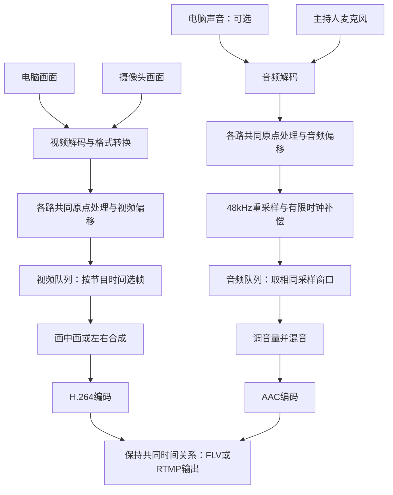

# 电脑录屏、摄像头、主持人麦克风：基础音画同步方案

依据：2026-11-15当前代码。本文解释现有实现如何用于这个场景，以及需要现场校准的部分；不新增采集模块或改动媒体代码。

## 1. 先说最终要做成什么样

节目里有电脑画面、主持人摄像头画面，以及主持人的声音。电脑如果还有游戏声，也要一起处理。

希望观众看到：

- 主持人张嘴时，能听到对应的那句话。
- 电脑里出现动作时，能听到对应的游戏声。
- 摄像头和电脑画面展示的是同一段现场过程，不是一边已经过了几秒，另一边还停在之前。

**当前代码采用的方案是：各路解码后放到节目时间轴上，用逐路偏移校准固定错位；视频按节目时刻选帧，音频按相同时段取采样并混音，最后一起编码、封装输出。**

但时间戳排得整齐，并不自动等于嘴型正确。独立设备的时间关系仍需要测量。

## 2. 三个来源，在代码里分成几路

“来源”不等于“轨道”。电脑可能同时有视频和声音，而麦克风只有声音。

| 现场来源 | 在程序里的位置 | 内容 |
|---|---|---|
| 电脑录屏 | inputs[0] → VideoSource | 电脑画面 |
| 摄像头 | inputs[1] → VideoSource | 主持人画面 |
| 电脑游戏声，可选 | audio_inputs[0] → AudioSource | 游戏/桌面声音 |
| 主持人麦克风 | audio_inputs[1] → AudioSource | 主持人说话声 |

上表按“保留游戏声”的情况编号。如果只要麦克风，就只有一项audio_inputs，麦克风索引变成0。
音频列表和视频列表各自编号，不能把audio_inputs[1]理解成必定属于inputs[1]，关联关系由我们配置。

当前支持2或4路视频，这个场景用2路，布局选pip（画中画）或split（左右拼接）。
pip中第一路电脑画面为主画面，第二路摄像头缩小后覆盖在右下角。

**当前代码没有直接采集桌面、USB摄像头、ALSA/PulseAudio麦克风的模块。**
它接收普通媒体文件、RTMP或RTSP流。现场使用时，需要上游采集程序先把设备信号变成受支持的媒体流。
输入解码器支持H.264/H.265视频和AAC/Opus音频；不能把设备路径或任意原始PCM地址直接当成现有输入。

## 3. 为什么一接上就可能不同步

### 原因一：每条路处理和传输的时间不同

摄像头可能经过曝光、编码、网络缓存；麦克风可能很快就送到程序。
它们即使采集的是同一件事，到达服务器的时间也可能不同。

所以不能用“先收到的先播放”来代替同步。收到时间反映传输过程，未必是内容发生时间。

### 原因二：各路说的“第0秒”可能不是同一时刻

电脑采集先启动，摄像头晚一点启动，麦克风又独立启动。三个来源都可能从PTS=0开始。
把三个0放在一起，不代表把现实中的同一时刻放在了一起。

当前代码会减去每个输入容器的起点。这样便于处理各路时间，但不会自动恢复独立设备之间真实的启动差。

### 原因三：设备的时钟可能慢慢走偏

两台设备都声称一秒，却可能一台稍快、一台稍慢。开始看起来对齐，过一段时间逐渐错开。
这种“误差越来越大”不能仅靠一次固定偏移解决。

还要区分随机网络抖动：有时晚一点、有时早一点。固定偏移只能纠正常量差，不能消除任意变化的网络等待。

## 4. 先认识一个最重要的词：PTS

可以把PTS理解成“这份画面或声音应该出现在媒体时间轴的哪个位置”。
它不是服务器收到包的时间，也不必然是可跨设备直接比较的真实采集时钟。

PTS只是整数，还要配合time_base（每一格代表多久）才有意义：

| 表示方法 | 数值 | 对应时刻 |
|---|---|---|
| 视频输入的某种时间基1/90000 | PTS=90000 | 1秒 |
| 程序视频队列中的微秒 | PTS=1000000 | 1秒 |
| 48kHz音频的采样位置 | PTS=48000 | 1秒 |

三种数值都可以指同一时刻。因此不能直接比较90000和48000，认定视频比音频晚。
代码用av_rescale_q换算，用av_compare_ts比较不同单位的时间。

DTS表示压缩包的解码时间。初学这套同步方案时，先沿解码后的Frame PTS理解内容位置；最终写容器时，封装器还要正确处理包的PTS和DTS。

## 5. 第一步：保留同一来源内部原有的音画关系

相关代码：[container_origin_us](../include/sync/av_synchronizer.h)、[VideoSource::run](../src/input/video_source.cpp)、[AudioSource::run](../src/input/audio_source.cpp)。

电脑录屏如果已经带游戏声，我们希望保留它原本正确的声音与画面关系。
代码优先使用容器的共同起点，视频和音频都减这个共同起点，而不是各自减首帧时间。

举例：原文件声音从10.000秒开始，画面从10.100秒开始；共同起点为10.000秒。
归一化后声音从0开始，画面从100ms开始，原来的100ms差保留下来。
如果两者分别减自己的第一帧，它们会都变成0，这个关系就被改变了。

**为什么这样做：统一起点时不能顺手破坏原有轨道偏移。**

边界也要记住：当前同一个URL的视频与音频由两个线程分别打开。对于文件，通常能取得一致容器信息；对于实时流，两次连接的起始位置和时间戳信息可能不同，不能保证天然对齐。
如果容器没有起点，代码回退到首帧；此时跨轨偏移更需要实测，不能把回退当成精准同步。

## 6. 第二步：用同一个事件测出固定错位

先把偏移设为0，观察或录制一次实际合成输出。

- 摄像头与麦克风：让主持人在镜头前拍手，比较“手掌接触的画面”和“拍手声”的位置。
- 电脑画面与游戏声：播放带同步闪光/提示音的测试素材，比较闪光和提示音。
- 电脑画面与摄像头：让摄像头临时拍到显示器中的同一次闪光，比较两个画面中闪光的位置。

先分别确认每对关系，再建立全部来源的关系。主持人说话和游戏动作本身可能有自然反应时间，不要把正常反应强行校准成零。

记录的应是**同一事件在输出或归一化媒体时间轴上的位置差**，不能只测两个网络包的到达时间差。
多做几次：如果每次差值接近，就适合固定偏移；如果差值大幅变化，应先检查上游缓冲和网络抖动。

## 7. 第三步：把较早的内容延后，摆到同一个节目时刻

假设一次校准得到下表。所有数字仅为教学例子，不是这些设备必然有的延迟：

| 同一测试事件 | 偏移为0时的媒体位置 | 对齐到1200ms所需偏移 |
|---|---:|---:|
| 电脑画面中的闪光 | 1080ms | +120ms |
| 与电脑画面已同步的提示音 | 1080ms | +120ms |
| 摄像头拍到该闪光 | 1200ms | 0ms |
| 已通过其他共同事件测定关系的麦克风声音 | 1000ms | +200ms |

麦克风不能“听到闪光”。表中麦克风关系必须通过拍手或其他可同时观察的事件另外测定，再换算到同一基准。

计算就是：

```text
每路需要增加的偏移 = 目标事件位置 - 该路当前事件位置
电脑画面：1200 - 1080 = 120ms
主持人声音：1200 - 1000 = 200ms
```

将早到时间位置的内容向后放，通常比试图让尚未到达的数据提前播放更可行。代价是增加等待和节目延迟。
也可以统一再加一段余量，但当前程序没有自动测量并选择全局缓冲时长的控制器，需要人工评估。

配置中的正数表示节目位置后移；负数表示前移，**负偏移不能让网络中尚未到达的帧凭空出现**。

代码里的主要计算可按下面理解（还有异常PTS修复）：

```text
视频节目位置（微秒）= 输入PTS换成微秒 - 容器起点 + video_offset_ms × 1000
音频节目位置（采样）= 相对容器起点换成48kHz采样位置 + audio_offset_ms × 48
```

例如麦克风+200ms，就是把声音起点增加9600个采样位置。前面没声音的区间保持静音。

### 配置示例：有游戏声，也有主持人声音

下面使用占位的本地媒体路径说明字段对应关系；现场可替换为有效RTMP/RTSP输入。
数值沿用上面的假设测量结果，真实使用必须重新测量。文件需要自行准备，输出路径必须尚不存在。

```json
{
  "inputs": ["media/screen.mp4", "media/camera.mp4"],
  "audio_inputs": ["media/screen.mp4", "media/host.m4a"],
  "output": "build/sync-demo.flv",
  "layout": "pip",
  "width": 640,
  "height": 360,
  "fps": 25,
  "realtime": true,
  "video_offsets_ms": [120, 0],
  "audio_offsets_ms": [120, 200],
  "gains": [0.3, 1.0],
  "muted": [false, false]
}
```

这里音频0来自电脑，音频1来自主持人，摄像头自带麦克风没有加入混音，避免同一句话从两路重复播放。
gains只是示例音量，不参与时间同步；调整音量不能修复嘴型错位。

如果不要游戏声，改为以下四个字段，其他设置保持对应场景所需的值：

```json
{
  "audio_inputs": ["media/host.m4a"],
  "audio_offsets_ms": [200],
  "gains": [1.0],
  "muted": [false]
}
```

这段是需要替换的字段片段，不是完整可运行配置。此时麦克风索引为0。
不要把audio_inputs设成空数组表达“关闭游戏声”，因为当前空数组会继承视频输入列表的音轨。

## 8. 第四步：节目按自己的节奏取内容

相关代码：[run_live](../src/manager/live_pipeline.cpp)、[FrameQueue](../include/queue/frame_queue.h)、[AudioQueue](../include/queue/audio_queue.h)。

主线程维护两把计数尺：视频帧序号tick和音频采样位置cursor。它比较下一视频帧和下一音频块的时间，先处理更早的一项。
实时模式再根据单调时钟控制节奏，避免一下把几分钟内容全部发出去。这里并不是“选麦克风作为主时钟”。

### 视频：取不晚于当前节目时间的最新画面

假设节目现在到1000ms，摄像头队列中有960ms、1000ms和1040ms三张图。
程序选择1000ms，1040ms留到以后。上游帧率高时可能跳过部分旧帧，低时可能重复上一张画面。
这样电脑60fps和摄像头30fps也可以被制作成统一25fps节目；当前没有运动补帧算法。

暂时没新画面时沿用旧画面；旧画面超过stale_ms则用黑帧。stale_ms是过期判定，不是专门的“延迟视频多少毫秒”设置。

### 音频：取同一段时间，缺的地方先留静音

以48kHz音频为例，主线程要制作采样区间[48000,49024)，也就是从1秒开始的一小段声音。
它分别向电脑音频队列和主持人音频队列索取这一段，取到后才求和混音。

较早步骤已经把麦克风+200ms，所以队列会按调整后的时间位置选取对应内容。
没有覆盖到的部分保持静音，不重复上一块声音。

**为什么这样做：混音不仅要格式相同，还必须是同一时间段；否则声音虽然加在一起，内容却不是同一个时刻。**

实时模式不会无限等慢源。偏移只是改媒体位置，并没有自动保证所有输入及时到达；延迟余量和队列容量不足仍会导致黑帧、静音或过期数据丢弃。

## 9. 第五步：避免声音越播越歪，但要理解补偿范围

相关代码：[AudioResampler](../src/sync/audio_resampler.cpp)、[SourceClock](../include/sync/av_synchronizer.h)。

先把各种输入音频统一成48kHz、双声道、FLTP，混音器就可以按同样的采样格式处理。
转换格式之外，代码还比较“输入PTS指示的位置”和“重采样器预计的位置”：

| 当前实现 | 通俗解释 | 原因 |
|---|---|---|
| 差值不超过24采样 | 暂不补偿；48kHz下24采样是0.5ms | 不对极小误差频繁调整 |
| 超过24、但不超过4800采样 | 通过swr_set_compensation渐进调整输出采样数；每次限制±240采样，在48000采样距离内补偿 | 避免直接删掉或重复一大块声音造成突变 |
| 超过4800采样，即100ms | 重建重采样状态；输出位置不向后倒退，前向缺口留待队列补静音 | 将大间断和小漂移分开处理 |

这些判断之前，SourceClock还会修补缺失、回退、重复或超过两秒的异常跳变。因此表中误差是经过源时间修复后与重采样预测位置比较的结果。

**这个补偿器没有读取摄像头嘴型，也没有把麦克风时钟与摄像头时钟直接比较。**
它主要修正输入PTS和音频采样推进之间可观察到的不一致。
如果独立设备的采样与PTS一起按同一个偏快时钟增长，本模块未必能察觉它相对于另一台设备的漂移。
所以不能声称它已解决所有跨设备长期同步问题；固定offset也不能解决持续增长的相对误差。

## 10. 第六步：把已经对齐的内容一起输出

相关代码：[MediaEncoder](../src/codec/media_codec.cpp)、[StreamOutput](../src/output/stream_output.cpp)、[AsyncOutput](../src/output/async_output.cpp)。

视频合成为一条画面，音频混为一条声音，然后分别编码成H.264和AAC。输出端把两者交错封装进同一FLV/RTMP会话。
换成编码器时间基、再换成容器时间基时，内容时刻应保持不变。

网络输出重连时，以新视频关键帧的DTS作为音视频共同原点。不能分别把视频和音频各自归零，否则重新连接可能改掉原有偏移。
早于新会话原点的AAC预卷包会被丢弃。输出积压超过预算时可能清理旧窗口、等待新关键帧，以追上实时节目。
这意味着故障恢复可能有内容缺口，并不保证一帧不丢。

**封装保证正确表达我们已经安排好的时间关系；它不能把前面配错的嘴型自动修好。**

## 11. 三个来源串起来，整体就是这样



图中的解码和输入队列按路独立，节目合成/混音由主线程调度，输出由另一个线程写入。

## 12. 现场怎样确认有效，而不只是“配置没报错”

1. 明确音频列表，只接需要的游戏声和主持人麦克风，避免摄像头音轨重复收声。
2. 偏移归零，用共同测试事件测出录屏、摄像头和麦克风之间的固定差。
3. 填入逐路offset，重新启动程序，再录一段检查。当前配置没有热更新。
4. 在开始、中间和较长时间后重复校准事件。差值一直固定，通常继续微调offset；差值持续增长，要检查设备时间基和上游采集时钟。
5. 观察网络抖动时有无黑帧、静音、队列堆积。增大缓冲会增加延迟，不能把所有卡顿都归为offset错误。
6. 最后在实际播放器上看嘴型、听声音。同步报告的av_delta_us只表示两条节目轨道的处理终点差，不能代替内容同步测量。

队列容量是帧数/块数，不能直接当作可用缓冲毫秒数；要结合实际帧率和每块采样数估算。
例如25fps视频的4帧约160ms，音频每块若恰为1024采样，16块约341ms；实际重采样块长可能变化，这些只是容量量级示例，不是全链路延迟保证。

## 13. 当前能做到什么，后续还需要什么

现有代码已提供格式统一、时间戳换算、逐路手动偏移、按时选帧/取音频窗口、音频有限补偿以及共同时间关系的封装输出。

针对独立录屏、摄像头和麦克风，仍需要上游采集、共同事件测量与现场验收。当前没有自动跨设备时钟标定、自动嘴型检测、共享采集会话或自适应全局抖动缓冲。

如果目标是独立设备长时间运行也严格对齐，后续设计应保留可比较的采集时间，建立“各源时钟→节目时钟”的映射，持续估计偏移和时钟快慢，并配套有限等待缓冲。
这是后续设计方向，不能当成当前已有实现；本轮没有实施这些功能。

先记住这三个动作就能读懂现有方案：**先测关系并调整时间位置，再在同一节目时刻取内容，最后一起编码输出。**
